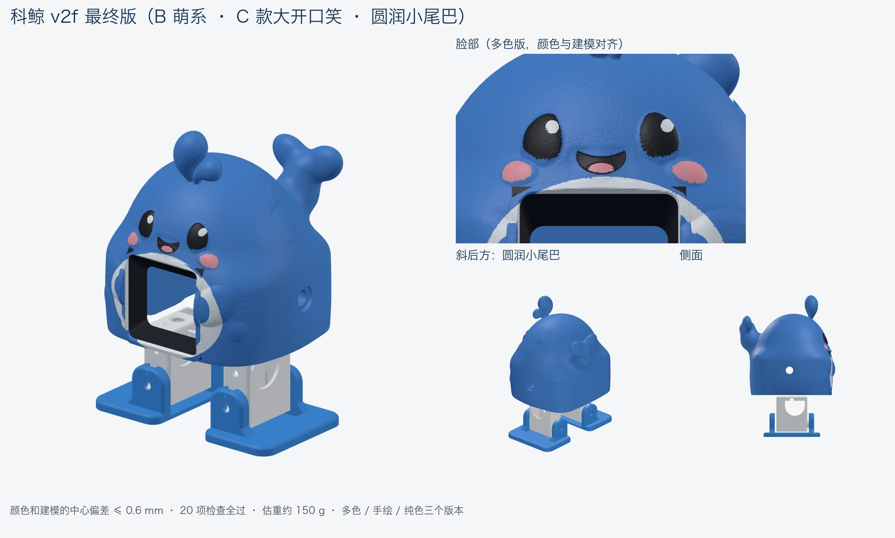

# 虹桥科技周 · 科鲸桌面导游机器人

> 2026 虹桥国际科技周黑客松（11/20–22，上海，硬件赛道）作品：
> 给开源社区 Datawhale 的吉祥物「科鲸」做一台会说话、会走路、能导览的桌面 AI 机器人。

## 一句话介绍

以开源的**小智 AI Otto 双足机器人**（奶龙同款硬件：ESP32-S3 + 4 舵机 + 1.54 寸圆屏 + 云端大模型对话）为内部，重新设计 **Datawhale 科鲸造型外壳**——胸口圆屏显示表情，鱼鳍抱屏，头顶可换导游帽，鱼鳍可举小旗。赛后外壳模型与教程开源回馈社区。

**三位一体架构**（详见 [docs/architecture.md](docs/architecture.md)，交接快照见 [HANDOFF.md](HANDOFF.md)）：
脑 = 智库 [datawhale-wiki](https://github.com/Dalaoyuan2020/datawhale-wiki)（私有，212 卡）· 体 = 科鲸机器人 · 场 = 桌面地图垫导览 DEMO · 集成 = guide_query 自定义 MCP。

## 仓库结构

```
├── README.md                 # 本文件
├── concepts/                 # 概念图 + 选型记录
│   ├── A_ip_whale.png        # 概念A：IP还原款
│   ├── B_qwhale.png          # 概念B：Q版萌系款（已选定基调）
│   ├── C_guide_whale.png     # 概念C：导游款（配件元素并入B）
│   ├── datawhale-logo.png    # Datawhale 官方 logo（简笔蓝鲸）
│   └── gate_shell_style.html # 交互选型页（存档）
├── assets/datawhale_refs/    # Datawhale 鲸鱼形象参考素材
├── docs/
│   ├── interface_spec.md     # ⭐ 新外壳接口硬约束（建模必读）
│   ├── print_order.md        # 代打清单与下单话术
│   └── nailong_wiki_notes.md # 奶龙机器人 Wiki 情报摘录
├── plan/timeline.md          # 赛前倒排计划
├── cad/                      # 科鲸壳生成脚本、切片说明（STL 含原版几何，不入库，见 cad/README.md）
└── firmware/otto-jingbao/    # ⭐ 机器人固件：唤醒词「你好鲸宝」，现场烧录/恢复/重编步骤（队友接手看这里）
```

## 外壳最终版 v2f（2026-11-13）



- 造型：B 盲盒萌系（效果图 `docs/images/concept_B_dome.jpg`）→ 混元 3D 转模型 → 程序拼上奶龙原版接口（底座腔体、卡销、屏幕窗口逐面照抄原壳）。
- 嘴是 C 款大开口笑加舌头（三选一见 `docs/images/mouth_options.jpg`），尾巴重新建模成圆润的小尾巴。眼睛、腮红、嘴的颜色按建模的真实轮廓上色，偏差不超过 0.6 mm（`docs/images/color_alignment.jpg`）。
- 打印友好：腔体顶改成 45° 斜顶，不用填支撑；入口有 0.8 mm 防象脚倒角。20 项自动检查全过（`cad/kejing_shell_v2f_CHECKS.md`）。
- 颜色：A 拓竹 AMS 四色直出 / B 单色加描边槽手绘 / C 纯色，三个版本。切片参数见 `cad/PRINT_GUIDE.md`。
- 实测接口（纠正了 `docs/interface_spec.md` 里屏幕位置等说法）：`docs/shell_interface_measured.md`。
- **STL 文件不在本仓库**（含奶龙原版接口几何）：在群里拿打印包 `kejing_v2f.zip`，或者下载奶龙模型包后按 `cad/README.md` 的流水线自己生成。

## 技术底座（内部已完成，不改动）

| 部件 | 规格 |
|---|---|
| 主控 | ESP32-S3-WROOM-1U-N16R8 |
| 舵机 | SG90 ×4（两腿两脚，走路/跳舞动作） |
| 屏幕 | 1.54 寸 240×240 圆屏 ST7789（胸口，表情+字幕） |
| 音频 | ICS-43434 麦克风 + MAX98357A 功放 + 2828 喇叭 |
| 电源 | 103450 2000mAh 锂电 + TP4054 充电 |
| 对话 | xiaozhi.me 云端（ASR → LLM+人设 → TTS），MCP 协议下发动作指令 |

**改壳策略**：原版外壳共 8 个 STL，其中 **只重新设计 `01_奶蛙外壳.stl`**（108×118×113 mm），底座、左右卡销、腿、脚共 7 件原样保留——机械接口零风险。

## 外壳设计方向（已选型）

**B 款 Q 版萌系为基调 + 导游配件系统**：
- 圆滚滚蓝鲸身体、白肚皮、弯弯笑眼、头顶小水柱
- 胸口圆屏由两只鱼鳍环抱
- **可拆卸配件**（外壳预留安装口）：导游帽（头顶卡槽）、导游旗（鱼鳍/背部旗杆孔 Ø3mm）——比赛时装上即「桌面导游」，社区版可拆成素款
- 配色：Datawhale 蓝（参考 logo 深蓝→浅蓝渐变）+ 白肚 + 蓝脚

## 致谢与来源

- **奶龙机器人**（知造 ZhiForge，2026 知乎黑客松作品）：本体结构与 Wiki 参考 https://nailong.nekokax.com ，外壳模型包见其 Wiki 下载页（本仓库不直接分发其 STL，请从原站下载）
- **小智 AI**（78/xiaozhi-esp32）、**Otto 小智版**（txp666/xiaozhi-esp32）：固件
- **Datawhale**：形象参考 https://www.datawhale.cn

## 赛程

- 11/13 晚：群内建模出壳（v1）→ 建模产出进 `cad/`
- 11/14：淘宝代打下单（7 件原版 + 1 件新壳 + 配件小件）
- 11/16–17：到货试装、修公差
- 11/20–22：虹桥国际科技周黑客松现场
